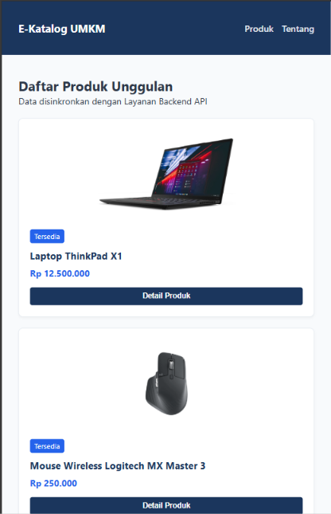
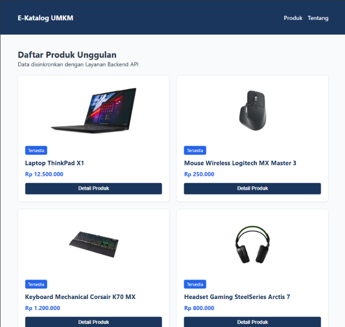
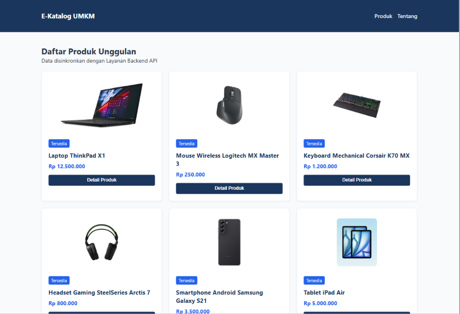

# Dokumentasi Tugas Praktikum 2

Berikut adalah hasil pengujian responsivitas halaman katalog UMKM menggunakan Toggle Device Toolbar:

### 1. Tampilan Mobile (< 768px)
Pada resolusi ini, grid menampilkan 1 kolom.

### 2. Tampilan Tablet (768px)
Pada resolusi ini, grid menampilkan 2 kolom.

### 3. Tampilan Desktop (>= 1024px)
Pada resolusi ini, grid menampilkan 3 kolom.

